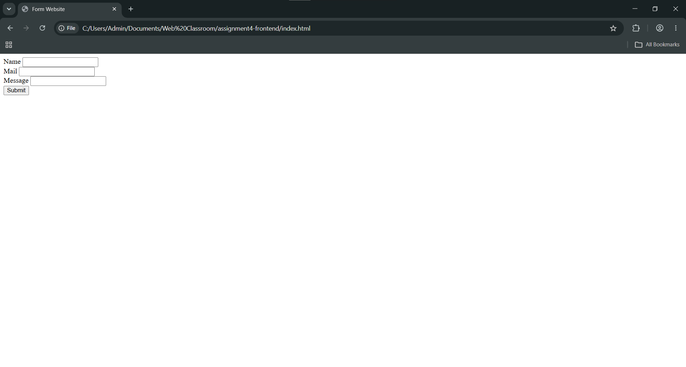
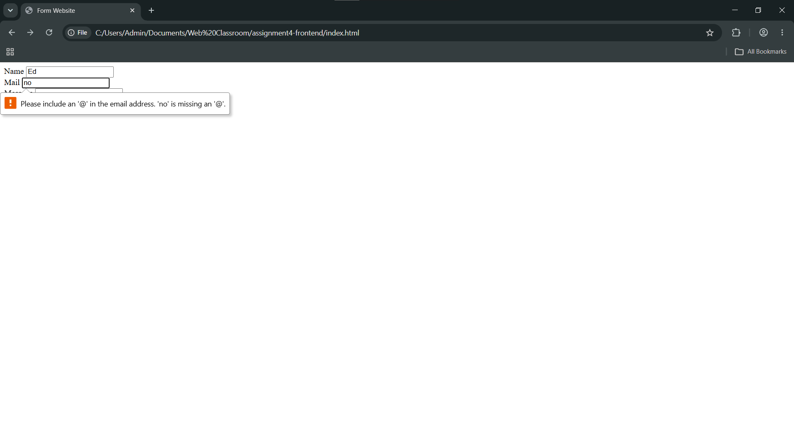
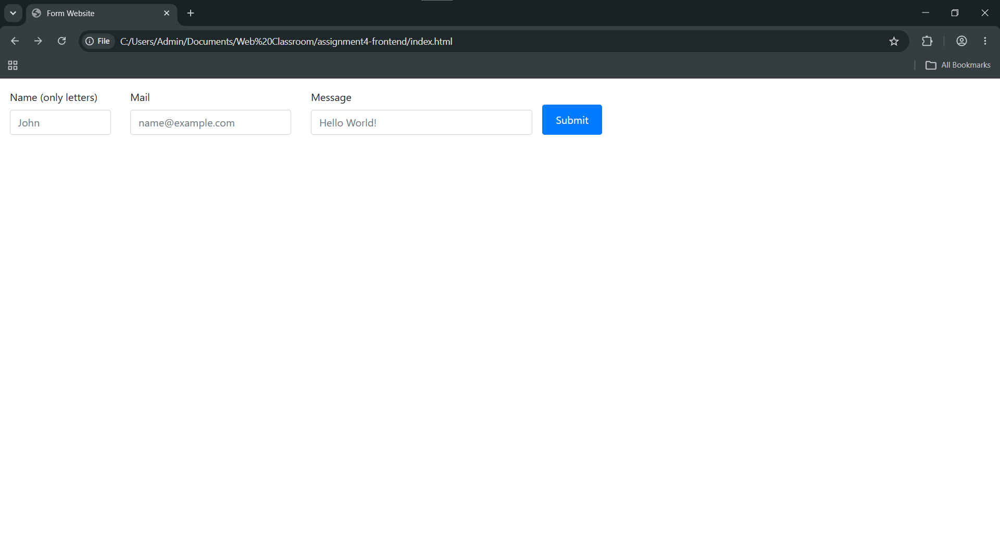
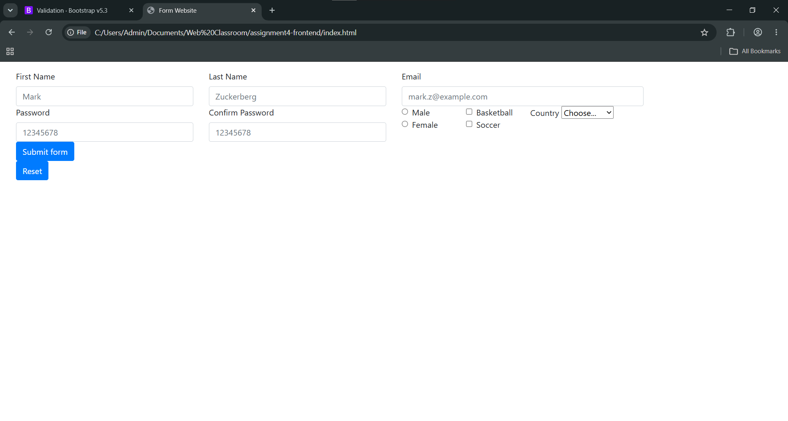

# Assignment 4: Forms and Validation
Fourth assignment for the `Web Technologies 1` course
### Reporter
`Mukhammedali Bolegen`, `SE-2538`
### Task 0

Basic `html` form.
### Task 1

Added requirements to input.
### Task 2

Added `Bootstrap` class styling and placeholder text in the input.
### Task 3 and 4

I decided to do Task 3 and 4 at once. I used bootstrap validator from [Bootstrap Docs](https://getbootstrap.com/docs/5.3/forms/validation/).
### Summary
In this assignment I learned how to combine `html` forms with `Bootstrap`.
