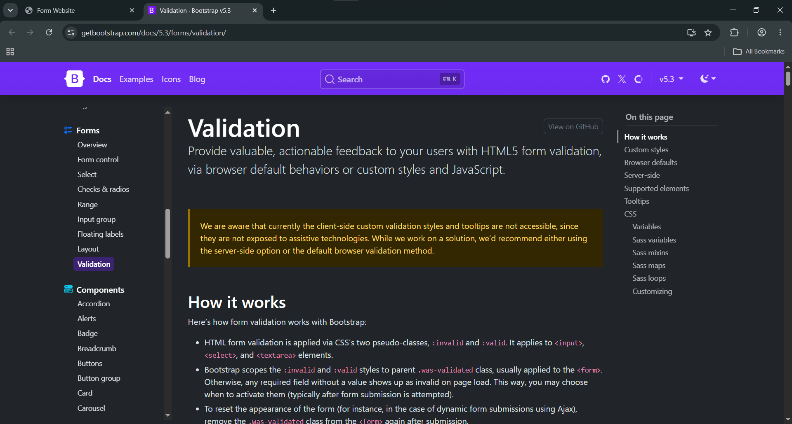

# Assignment 4: Forms and Validation
Fourth assignment for the `Web Technologies 1` course
### Reporter
`Mukhammedali Bolegen`, `SE-2538`
### Task 0

Basic `html` form.
### Task 1

Added requirements to input.
### Task 2

Added `Bootstrap` class styling and placeholder text in the input.
### Task 3

Currently `Bootstrap` validation doesn't work in the client-side. In other words, validation can work only through basic HTML/CSS, or using JavaScript.
### Task 4
Since checking if `password` and `confirm password` are equal requires JavaScript, and currently we haven't learned it yet, I cannot finish this part.
### Summary
In this assignment I learned how to combine `html` forms with `Bootstrap`.
